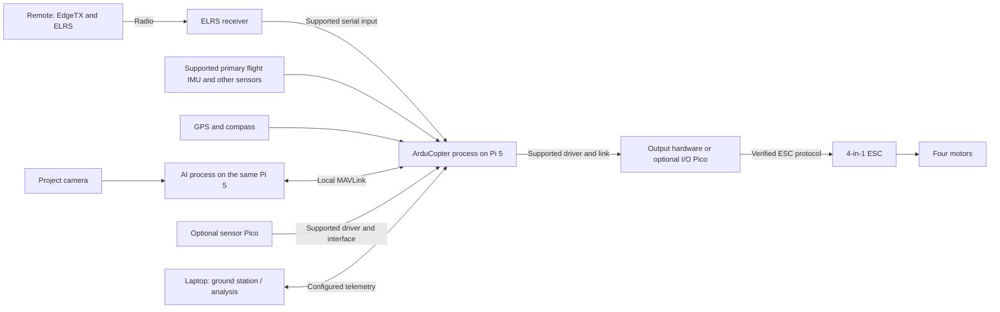

# Expandable DIY drone: research and project plan

**Current design — October 30, 2026:** **Pi 5 will run native ArduCopter and AI**, probably without a separate flight-control computer. Optional **Picos may manage sensors and other I/O**, subject to change. Use a custom CAD frame/electrical integration and separate FPV video path. Tentatively use 7-inch props, a 330–360 mm diagonal and common 6S voltage, with 3300–4000 mAh high-power LiPo for dynamic-flight development and space for 8000–10000 mAh high-power Li-ion endurance packs. Twenty minutes of frequent fast maneuvers/freestyle remains a stretch goal. Read the current [Pi flight-computer architecture](PI5_FLIGHT_COMPUTER_ARCHITECTURE.md), [battery/mounting study](ENDURANCE_AND_MOUNTING_PLAN.md) and [frame requirements](FRAME_REQUIREMENTS.md). The dry allocation is now 875 g including reserve; no hardware performance is validated.

**Movement and upgrade update:** Design/investigate a **2.2 kg future fully loaded configuration** with **2.2–2.5 kgf available peak thrust per motor**, giving approximately **4–4.5:1 at that mass**. Retain the lighter initial build and evaluate electrical, structural, thermal and control headroom before approving additions. The [movement and upgrade requirements](MOVEMENT_AND_UPGRADE_SPEC.md) contain the force calculations, proposed acceleration/angular-rate targets, manufacturer comparison and acceptance gates. They supersede the earlier 1.9 kg gross and 3:1 thrust screening assumptions; no payload capacity or movement performance is established.

**Historical research boundary:** Earlier purchased-FC BOMs, MCU/DShot wiring, Pi-companion budgets and build schedules below are comparisons, not the current implementation. The current architecture section and linked design documents supersede them. A custom Pi/Pico interface adds sensor/output drivers and timing validation; deleting an FC is not automatically a cost, weight or power saving.

Prepared October 29, 2026. Prices are USD. This plan assumes outdoor, remote-controlled flight, a small initial budget, and a future project that has not yet been chosen.

## Earlier recommendation — superseded by the current geometry

Build an open, repairable quadcopter with an H743 flight controller, an AM32 motor controller, a 2.4 GHz ExpressLRS radio link, and removable project electronics. Use ArduPilot as the primary project firmware. Keep Betaflight as an alternative if acrobatic freestyle becomes the main objective.

There are two sensible sizes:

- **5-inch budget build:** approximately **$510** for the aircraft, two flight batteries, GPS/compass, remote and its batteries, and charger. Best when cost and maneuverability are the priorities. Plan for small sensors and a Pi Zero-sized computer.
- **7-inch expansion build:** approximately **$665** for the equivalent equipment. My preference if room for improvements is now the priority and the extra approximately $155 is acceptable. It gives more propulsion capacity for additions, although it has greater inertia and needs more flying space.

These are planning budgets, not checkout quotes. Add tools if needed, repair spares, shipping/tax/import costs, and any required Remote ID hardware. The initial aircraft does not need an onboard Raspberry Pi, camera, goggles, or a GPU.

**A larger propeller size does not guarantee a larger electronics compartment.** Buy the frame only after laying out the actual battery, controller stack, cables, and proposed computer. If you expect a full Raspberry Pi 5, depth camera, or several large peripherals, consider a 500 mm development frame from the start.

The modular design will let you add projects without continually rebuilding the aircraft, but no inexpensive airframe provides unlimited payload, endurance, and acrobatic performance simultaneously.

## Design goals and boundaries

The first deliverable is a reliable, manually flown aircraft with recorded flight logs and a known baseline. The second is a simple programmable sensor platform. Autonomous behavior comes after both work.

| Requirement | Design response | Acceptance evidence |
|---|---|---|
| Low initial cost | Existing laptop, open firmware, no initial video system or companion computer | Itemized budget before ordering |
| High maneuverability | Modest weight, appropriate motor/propeller pairing, centrally located battery and payload | Controlled manual flight, acceptable motor temperatures and logs |
| Repairability | Replaceable frame arms, separate FC and ESC, common connectors | Replacement arm and props can actually be purchased |
| Expandability | Several spare serial interfaces, I2C, logging, project power connector, removable deck | Completed connection map, power budget, physical mockup |
| Ability to code | Python through MAVLink; optional Lua on the FC; C++ later | Validated telemetry interface and logger |
| Maintain remote control | RC receiver connects directly to the flight controller | Pilot can leave the experimental control mode using the radio |
| Future project flexibility | Add only the sensor or computer the chosen project needs | One measurable objective and test plan per upgrade |

The 5-inch build is an outdoor hobby aircraft, not a large indoor test platform. The 7-inch version has more spinning mass and will feel less nimble at comparable tuning. Heavy computation and payloads move the project toward a larger research aircraft.

## Possible solutions compared

The following complete-system allowances are my engineering estimates, not manufacturer bundle prices. Except for Crazyflie, they include a basic radio, charger, and two flight batteries; they exclude tools, FPV video, tax/shipping, and Remote ID. Exact parts and local availability can move the totals substantially.

| Solution | Planning allowance | Maneuverability | Expansion potential | When it makes sense |
|---|---:|---|---|---|
| Simulator and radio first | $85–120 | Learn without aircraft damage | All later hardware decisions stay open | Best first purchase while learning and choosing a project |
| 3–3.5-inch modular quad | $300–450 | Very responsive, lighter | Small sensors; little power or mounting space | Small flying sites and low repair cost matter most |
| 5-inch quad with an inexpensive F405 stack | $330–480 | Excellent when built and tuned well | Some navigation and external-computer options; limited onboard firmware features | Primarily a flying/freestyle project |
| **5-inch H743 quad** | **$430–600** | **Strong** | **Good for light project modules** | **Best budget compromise** |
| **7-inch H743 quad** | **$550–750** | **Strong, with more inertia** | **Better payload margin; verify actual bay dimensions** | **Preferred if future additions are a main requirement** |
| DIY 450–500 mm frame with supported H7 controller | $500–750 | Moderate compared with freestyle quads | Large, accessible electronics deck | Wiring, sensors, mapping, or computer experiments dominate |
| Holybro S500 V2 development kit | $750–950 complete | Moderate | Excellent access and documented integration | Pay more to reduce integration work |
| Holybro X500 V2 development kit | $850–1,100 complete | Moderate | Excellent documented development route | PX4, ROS 2, or a larger computer is already likely |
| Crazyflie 2.1+ indoor platform | $320–450 with basic PC radio/positioning additions | Agile indoors | Excellent software ecosystem; tiny physical payload | Learning control, indoor experiments, or swarms |

Manufacturer anchors: the [S500 V2 development kit](https://holybro.com/products/s500-v2-development-kit) is listed at $549 with Pixhawk 6C, M10 GPS, and telemetry. The [X500 V2](https://holybro.com/products/px4-development-kit-x500-v2) page currently lists the 6C version at $609 and sold out; older cached pages show different prices and availability. Neither price is the complete flying setup above.

The [Crazyflie 2.1+](https://store.bitcraze.io/collections/platforms/products/crazyflie-2-1-plus) is listed at $240. It uses the Bitcraze radio/deck ecosystem rather than the proposed ELRS system. A game controller normally connects through the PC; do not assume the Pocket radio binds directly. The [Crazyflie Brushless](https://store.bitcraze.io/) is $480 before accessories, making it a more expensive indoor research alternative.

I would avoid a custom flight-control PCB, a completely new stabilization implementation, or a heavy AI computer as the first milestone. Each adds cost and makes it harder to tell whether a problem comes from the aircraft, wiring, firmware, or experimental code.

## Hardware selection and budgets

### 5-inch build: lower cost and greater agility

| Item | Candidate/specification | Quantity | Budget |
|---|---|---:|---:|
| Frame | TBS Source One V6 5-inch or equivalent with replacement arms | 1 | $30 |
| Motors | EMAX E3 2306, 1700 KV, for the proposed 6S setup | 4 | $60 |
| Flight controller and ESC | Flywoo GOKU H743 PRO plus matching 55 A **AM32** ESC | 1 set | $120 allowance |
| Receiver | RadioMaster RP1 V2 2.4 GHz ELRS, or comparable UART receiver | 1 | $19 |
| Propellers | Compatible 5-inch, modest pitch; several sets | — | $12 |
| Flight batteries | 6S LiPo, approximately 1100–1300 mAh, suitable current capability | 2 | $60 allowance |
| GPS and compass | Compatible M10-class GNSS plus supported external compass | 1 | $30 allowance |
| Supporting hardware | Buzzer, capacitor if not included, XT60 lead, wire, insulation, straps | — | $20 |
| Project mounts | Lightweight removable tray and fasteners | — | $10 |
| **Aircraft equipment, including two packs and navigation sensor** | | | **$361** |
| Remote | RadioMaster Pocket ELRS | 1 | $71.50 |
| Radio batteries | Correct matched 18650 cells | 2 | $12 allowance |
| Charger | Genuine 1–6S balance charger, preferably AC input | 1 | $65 allowance |
| **Basic flying setup** | | | **$509.50** |

The [Source One V6 5-inch](https://www.team-blacksheep.com/products/product:8547) is listed at $29.95 and supports standard 30.5 mm and 20 mm stack patterns. The [EMAX E3 2306](https://shop.emax-usa.com/collections/new-products/products/e3-series-2306-brushless-motor-choose-kv) is listed at $14.99 per motor; its 1700 KV version is specified for 3–6S and 5–5.5-inch props. Begin with a manufacturer-supported propeller combination and verify temperatures/current in the finished aircraft.

I suggested 4S earlier. Both are viable. For this expanded plan, I would choose 6S/1700 KV if the budget permits, or 4S/2400 KV if locally available parts are significantly cheaper. Higher voltage can reduce current for a given electrical power; it does not by itself improve endurance or make the aircraft more maneuverable. **Do not put a 6S pack on the proposed 4S/2400 KV configuration without redesigning and validating the propulsion combination.**

### 7-inch build: more capacity for improvements

| Item | Candidate/specification | Quantity | Budget |
|---|---|---:|---:|
| Frame | TBS Source One V6 7-inch DC or equivalent with measured module space | 1 | $36 |
| Motors | iFlight XING 2806.5, 1300 KV class; verify mounting pattern | 4 | $136 |
| Flight controller and ESC | H743 PRO FC plus a compatible 60–65 A AM32 ESC; 65 A preferred here | 1 set | $140 allowance |
| Receiver | Same ELRS receiver class as above | 1 | $19 |
| Propellers | Compatible 7-inch, conservative pitch, including spares | — | $14 |
| Flight batteries | 6S LiPo, initially approximately 1800–2200 mAh; finalize by mass and current | 2 | $100 allowance |
| GPS and compass | Supported external unit | 1 | $30 allowance |
| Supporting hardware | Power wiring, capacitor, buzzer, insulation, straps | — | $25 |
| Project mounts | Removable deck, mounts, light ground clearance if needed | — | $15 |
| **Aircraft equipment, including two packs and navigation sensor** | | | **$515** |
| Remote and batteries | Same as the 5-inch build | — | $83.50 |
| Charger | Same charger class | 1 | $65 |
| **Basic flying setup** | | | **$663.50** |

The [Source One V6 7-inch DC](https://www.team-blacksheep.com/products/prod:source1v6) is listed at $35.95, with 313 mm wheelbase and approximately 173 g frame weight. It is an affordable frame candidate, not a guarantee that a particular companion computer fits.

The [iFlight XING 2806.5](https://shop.iflight.com/index.php?product_id=3199&route=product/product) is listed at $33.99. The 1300 KV version is approximately 54 g and uses 19 × 19 mm motor mounting. Its published peak-current figure is about 48 A at the listed test conditions, which motivates a larger ESC margin. That figure does not validate every 7-inch propeller combination.

A candidate separate ESC is the [Diatone MAMBA F65 AM32](https://www.diatone.us/products/mb-f65_128k-bl32-esc), listed at $56.99, rated 3–6S and 65 A per motor. Select the **AM32** product revision. A separate FC/ESC combination requires checking and, if necessary, repinning the connection cable. Identical connector shapes do not establish compatible pinouts. A current-sensor output must also be confirmed before budgeting for capacity-based battery monitoring.

The 7-inch propulsion selection is a starting design, not a fully validated shopping cart: confirm frame motor holes, exact prop test data, ESC fit, battery discharge capability, and the mounted computer layout before ordering.

### Shared costs, savings, and purchasing pitfalls

The [Pocket ELRS](https://radiomasterrc.com/products/pocket-radio-controller-m2) currently lists at $71.50 and requires two 18650 cells. Buy the **ELRS 2.4 GHz** version, with a regulatory domain appropriate to your location. The [RP receiver collection](https://radiomasterrc.com/collections/rp-series-receivers) lists the RP1 V2 at $18.99; compare diversity receiver prices before ordering.

The [SkyRC B6ACneo](https://www.skyrc.com/b6acneo) is one charger candidate: it supports 1–6S packs and provides 60 W charging from AC. Its higher DC rating does not mean you need an extra DC supply for basic charging. The $65 entry above is an allowance, not a verified retail quote. A cheaper DC-only charger can be sensible if you already own the correct supply; otherwise include that supply and cables in the total.

| Additional item | Planning allowance | Treatment |
|---|---:|---|
| Soldering iron, solder/flux, multimeter, hex drivers, cutter | $50–100 | Borrow good tools if possible |
| Current limiter for initial power-up | $10–20 | Bench tool, not installed flight equipment |
| Repair reserve | $25–50 | Props, replacement arm, wiring; a spare motor later |
| Remote ID module, if needed | $50–150 | Allowance only; confirm compliant product and current price |
| Shipping, taxes/import costs | Variable | Obtain landed totals before purchasing |
| FPV camera, transmitter, receiving display/goggles | Defer | Separate system; can substantially increase total cost |

A practical initial envelope is approximately **$600–700 for the 5-inch build** or **$750–850 for the 7-inch build** with basic tools and repair provision, before variable shipping/tax and any Remote ID module. Reuse existing tools to lower this.

To reduce cost first, defer the GPS/compass until the navigation phase, start with one flight battery, and omit video and companion computing. Those changes save approximately $60 on the 5-inch budget or $80 on the 7-inch budget. Keep the H743 controller if future programming remains the goal.

The [Flywoo product page](https://flywoo.net/products/goku-h743-pro-55a-32bit-128k-30x30-stack-plug-play-o4-o4-pro) combines FC-only, ESC-only, and complete-stack variants. Its visible starting price is **not a verified full-stack price**. The $120/$140 allocations are deliberately estimates. Some earlier low-cost suggestions are also obsolete: the [SpeedyBee F405 V4 60 A](https://www.speedybee.com/speedybee-f405-v4-bls-60a-30x30-fc-esc-stack/) is marked discontinued.

## The computers and what runs on each

### Flight controller: mandatory, onboard from day one

The H743 is a microcontroller, not a Linux computer. Its job is sensor sampling, attitude estimation, stabilization, motor commands, radio handling, logging, and configured failure responses. The proposed Flywoo board has a 480 MHz H743, 2 MB program flash, dual gyros, barometer, multiple UARTs, and onboard logging storage. Its hundreds of megabytes of logging storage must not be confused with working RAM for images or AI models.

I checked the [actual stable FlywooH743Pro firmware directory](https://firmware.ardupilot.org/Copter/stable/FlywooH743Pro/), not only the vendor compatibility claim. At the research date it reports [ArduCopter 4.7.2](https://firmware.ardupilot.org/Copter/stable/FlywooH743Pro/firmware-version.txt). Its [feature manifest](https://firmware.ardupilot.org/Copter/stable/FlywooH743Pro/features.txt) includes Lua scripting, CRSF, optical flow, precision landing, and external-navigation support; it excludes direct DDS and DroneCAN drivers in this build. Recheck the manifest for the release you install.

Its onboard filesystem is accessed through tools such as MAVFTP; do not assume it has a removable microSD slot. The [ArduPilot hardware definition](https://raw.githubusercontent.com/ArduPilot/ardupilot/master/libraries/AP_HAL_ChibiOS/hwdef/FlywooH743Pro/hwdef.dat) provides the board-specific mapping. Verify the actual barometer/board revision matches the supported target. H743 processor compatibility alone does not establish board compatibility.

ArduPilot documents [feature and RAM limits](https://www.ardupilot.ardupilot.org/copter/docs/common-limited-firmware.html). In particular, do not select an F4 board expecting the same scripting and navigation features. If native CAN peripherals or PX4 become requirements, reconsider the FC before purchase.

### Existing laptop: your first project computer

Use the computer you already own for editing code, firmware setup, simulation, telemetry inspection, and analyzing flight logs. Python and a code editor are sufficient to begin. For comfortable simulation, my practical target is 8 GB RAM minimum and 16 GB preferred; heavier Gazebo/ROS workloads benefit from more resources.

On a Mac, start with the stable QGroundControl release for setup and telemetry, plus Python. The [QGroundControl installation guide](https://docs.qgroundcontrol.com/en/getting_started/download_and_install.html) documents Mac support, including Apple Silicon. Mission Planner is another useful ArduPilot tool, particularly on Windows. For the most reproducible development environment, use the Linux/VM route supported by the firmware's build documentation; advanced simulations can be more work on a Mac than basic Python development.

Initially your code can process recorded logs without any wireless link. Laptop code can read a bench controller over USB, or a simulator over UDP. In-flight laptop communication requires a suitable telemetry link; the RC link alone does not automatically provide a full laptop MAVLink connection.

### Optional project computer: add when a project requires one

| Computer | Cost basis | Suitable tasks | Constraints and fit |
|---|---|---|---|
| No added computer | $0 | Flight logs, onboard firmware functions, lightweight FC scripts | Best starting choice |
| ESP32-S3 camera/sensor board | XIAO Sense listed at $13.99; allow $20–35 with wiring/regulation | Sensor collection, simple image experiments, small embedded models | No normal Linux/OpenCV environment; radio coexistence and firmware integration need attention |
| Raspberry Pi Zero 2 W | Official board price $15; allow $35–60 installed without camera | Python mission logic, telemetry routing, logging, modest processing | 512 MB RAM; camera workloads must be measured; 65 × 30 mm board |
| Used Pi 3/4 already owned or found locally | Price depends on market; allow $60–120 installed | More substantial Python/OpenCV work | More mass, power, mounting and cooling than a Zero |
| Raspberry Pi 5 | Board price depends strongly on RAM; allow $120–200 installed without camera | More capable OpenCV, selected ROS 2 and perception workloads | Requires a strong regulated supply and cooling; choose a larger deck |
| Pi plus AI Camera | Add camera cost, cable and mounts | Supported neural-network inference with processing on the image sensor | Model conversion/compatibility limits; not a universal GPU |
| Jetson Orin Nano Super development kit | NVIDIA currently lists $399 for the kit; allow $450–600 installed before camera | Larger neural networks and more demanding perception | Better suited to a larger aircraft or ground-based development initially |

The [XIAO ESP32-S3 Sense](https://www.seeedstudio.com/XIAO-ESP32S3-Sense-p-5639.html) has camera support and additional PSRAM; [its documentation](https://wiki.seeedstudio.com/xiao_esp32s3_getting_started/) explains current camera revisions and Arduino/MicroPython support. Choose this route if learning embedded sensors is itself the project.

The [Pi Zero 2 W](https://www.raspberrypi.com/products/raspberry-pi-zero-2-w/) is the smallest practical Linux starting point here. Its advertised board price excludes the microSD card, voltage regulator, connectors, mount and camera. **Do not buy the original single-core Pi Zero W by mistake.**

The [Pi 5 specification](https://www.raspberrypi.com/products/raspberry-pi-5/) calls for 5 V/5 A input capability and benefits from active cooling under sustained load. That is a supply design requirement, not a claim that every workload consumes 25 W. Raspberry Pi has changed prices repeatedly; the [October 2026 announcement](https://www.raspberrypi.com/news/price-increases-for-2gb-raspberry-pi-4-and-raspberry-pi-5/) alone moved the 2 GB Pi 5 to $77.50. Check the specific current RAM variant rather than assuming old launch pricing.

The [Raspberry Pi camera documentation](https://www.raspberrypi.com/documentation/accessories/camera.html) distinguishes ordinary, AI and global-shutter cameras. The AI Camera's [product brief](https://pip-assets.raspberrypi.com/categories/1044-raspberry-pi-ai-camera/documents/RP-008147-DS-1-ai-camera-product-brief.pdf?disposition=inline) lists $70. It can be an interesting middle ground before a GPU computer. Its neural-network restrictions must match the intended application.

For Jetson, old articles quote $249, but [NVIDIA's current marketplace](https://marketplace.nvidia.com/en-us/enterprise/robotics-edge/jetson-orin-nano-super-developer-kit/) lists $399, with 7–25 W power modes. Treat this as a stretch option. A full development kit with cooling, regulator and camera can overwhelm the space and mass budget of a small freestyle frame.

## Firmware and software architecture

### Choose firmware for the actual project

| Firmware | Main strength | Programming route | Hardware implication |
|---|---|---|---|
| Betaflight | Fast manual FPV and acrobatics | Configuration, logs, changes to core firmware | Proposed Flywoo supports it; minimal navigation project infrastructure |
| ArduPilot | Broad navigation, sensors, missions and vehicle behaviors | Python/MAVLink, onboard Lua, core C++ | Recommended default for this project |
| INAV | Assisted flying and navigation with an FPV-oriented workflow | Configuration and source changes | Supported alternative, but I would choose ArduPilot for the proposed coding path |
| PX4 | Robotics development, offboard control, ROS 2 integration | MAVSDK, ROS 2, C++ | Choose an explicitly supported board such as Pixhawk 6C; do not assume Flywoo compatibility |

ArduPilot's [companion-computer architecture](https://ardupilot.org/dev/docs/companion-computers.html) permits mission logic or sensor processing outside the FC. Betaflight's [setup guide](https://betaflight.com/docs/wiki/getting-started/setup-guide) explains its Angle and Acro modes. ArduPilot can also fly manually and has Acro, but the project ecosystem is the reason to choose it here.

Do not switch firmware repeatedly during early testing. Choose one stable release, establish a working configuration, record it, and change one subsystem at a time. Betaflight and ArduPilot can differ in motor numbering, output assignment, sensor orientation, modes and parameter meanings. A flash followed by old settings is not a valid conversion procedure.

### Current control and information paths



ArduCopter on Pi handles estimation, fast stabilization and motor mixing. AI requests bounded high-level behavior through a local endpoint rather than calculating individual motor speeds. Optional Picos acquire peripheral data or perform defined I/O; they do not run stabilization in this plan. Sensor messages and output commands require explicitly supported ArduPilot drivers/backends.

Connect the receiver through a supported input path to ArduCopter, independent of the AI application. An AI-process exit need not stop ArduCopter, but a Pi reboot/power loss/kernel failure stops stabilization. A Pico watchdog may enforce a defined stale-output action; it cannot hold attitude or land without a separate flight-control implementation. Test scheduling, sensor freshness, output timing and failure behavior under simultaneous AI/camera/logging load before flight. See the [current architecture requirements](PI5_FLIGHT_COMPUTER_ARCHITECTURE.md).

**Keep three types of communication distinct:** RC commands, MAVLink telemetry/control data, and video. A camera attached to a computer is not automatically an FPV video system. Analog FPV cameras do not directly plug into a Pi CSI connector. Video consumes much more bandwidth than typical telemetry.

### Low-cost telemetry choices

1. **Start with USB on the bench and UDP in simulation.** This costs nothing beyond a suitable USB cable.
2. **Use ordinary ELRS/CRSF for early manual flights.** Battery/link telemetry on the handset is useful; it is not a general laptop data pipe by default. Follow the [ELRS ArduPilot setup](https://www.expresslrs.org/quick-start/ardupilot-setup/) for the installed firmware.
3. **Add a dedicated telemetry radio if reliable laptop communication becomes necessary.** Allow approximately $35–80 for an appropriate pair and cables; confirm legal frequency and power locally.
4. **Consider ELRS MAVLink mode to avoid a separate radio, if the complete hardware path supports it.** [Official ELRS instructions](https://www.expresslrs.org/software/mavlink/) specify ESP-based TX/RX hardware and additional ground-station connection requirements. Internal modules require a compatible TX Backpack path; do not assume the Pocket's USB joystick port exposes this. Treat Backpack availability or an external module as an additional purchasing decision. Changing link mode also changes configuration and bandwidth tradeoffs.

## Leave room electrically and physically

### Mechanical layout

Create full-size paper or CAD rectangles for the FC/ESC, battery, GPS, receiver antenna, future computer and all connector exits before purchasing the frame. Check the propeller sweep in plan view and the heights of the battery and deck in side view.

Design targets, to be verified with the real frame:

- Standard 30.5 × 30.5 mm FC mounting, with the manufacturer's vibration grommets.
- A removable **approximately 70 × 35 mm usable area** for a Zero-sized computer, plus connector/ribbon clearance outside that area.
- If a full Pi is likely, mock up at least its actual 85 × 56 mm board envelope **plus** plugs, cooling and restraint. Move to a larger frame if this interferes with the battery or propeller envelope.
- Battery and payload close to the center of mass, with separate retention. Keep heavy items low and near the center rather than on tall posts or arm ends.
- GPS/compass away from motor power wiring and magnetic hardware; antennas clear of conductive carbon and propeller paths.
- A downward optical-flow/range sensor needs an unobstructed view and adequate ground clearance; landing gear changes mass and drag.
- Protect electronics from direct shorts against carbon. Use suitable insulation and strain relief; route wires away from propellers and sharp edges.

A simple removable project tray is preferable to permanently embedding experimental electronics. Design an “agile” configuration without the tray and an “experiment” configuration with it. Any material mass/center-of-gravity change needs a new flight assessment; a stored parameter profile alone does not validate it.

### Reserve interfaces

| Interface reservation | Initial or future purpose |
|---|---|
| One full hardware UART pair | ELRS receiver |
| One UART plus external I2C | GPS and compass |
| One spare full UART | Companion computer using MAVLink |
| One spare UART | Telemetry radio or a serial range/flow module |
| Additional UART if needed | ESC telemetry, video OSD, or a future sensor |
| I2C expansion | Supported external sensors, with voltage/address checks |
| USB access | Setup, updates and logs without dismantling the aircraft |
| Project power connector | Switched/removable computer and sensor supply |

This is a role allocation, not a ready-to-flash pin assignment. The board's UART labels and ArduPilot's SERIAL numbers are not universally identical. Record each physical pad, voltage, firmware port and device in a wiring document. Leave an interface unused rather than consuming every available connection at the start.

The budget Flywoo board is not a native DroneCAN expansion choice. If you want CAN GNSS, multiple robust CAN sensors, or native PX4 support, a Pixhawk-class controller is a sensible upgrade. The [Holybro controller comparison](https://docs.holybro.com/autopilot/controller-comparison) documents CAN, power and interface differences. The current [Matek H7A3-SLIM](https://www.mateksys.com/?portfolio=h7a3-slim-2) is another ArduPilot-oriented candidate with CAN, but its manufacturer page does not establish the same Betaflight compatibility as the Flywoo; verify the exact desired firmware before selecting it.

### Power architecture

```text
Flight battery
  +-- high-current wiring --> ESC --> four motors
  +-- supported FC input/regulation --> FC, receiver, small sensors
  +-- dedicated regulated project supply --> optional computer and camera

Common signal ground; correct logic levels; independently checked connector pinouts.
```

Size every device for the **fully charged** pack: ordinary 4S LiPo is 16.8 V, and ordinary 6S is 25.2 V. Use a regulator with adequate input-voltage and transient headroom. Follow the ESC manufacturer's capacitor and battery-wire requirements.

For a future Zero-based project, reserve a good regulated 5 V supply with appropriate current headroom; a 3 A class supply is a useful planning point, subject to the camera/peripheral load. For Pi 5, plan a correctly implemented 5 V/5 A-capable supply and cooling. A regulator's label is not a substitute for voltage/ripple and thermal testing under the actual workload.

Do not power a companion computer from a lightly rated telemetry port. Avoid unplanned parallel power paths through USB or multiple 5 V rails. Use shared signal ground and confirm 3.3 V-compatible UART logic; never connect battery voltage or 5 V signaling to Pi GPIO. [ArduPilot's Pi connection guide](https://ardupilot.org/dev/docs/raspberry-pi-via-mavlink.html) explains serial wiring and why the computer power budget needs separate attention.

Illustrative accessory budget, not measured consumption:

| Load | Example design current at 5 V |
|---|---:|
| Receiver and small sensors | 0.3 A allowance |
| Pi Zero plus selected camera during peak load | 1.0 A provisional allowance |
| Sum | 1.3 A |
| With 30% margin | 1.69 A |

Measure startup and workload peaks before flight. Keep the computer on a separate regulator so its peak demand is less likely to upset the flight electronics. A separate regulator still shares the main battery and does not provide complete fault isolation.

### Mass, thrust and endurance budget

Weigh every installed part, including pack, camera, wire, mounts, hardware and any Remote ID module. Initial design targets are roughly 650–800 g all-up for the 5-inch build and 950–1250 g for the 7-inch build. These are targets to check, not predictions or approved payload ratings.

The earlier lightweight-platform study used 3:1 total maximum thrust to all-up weight as a preliminary screening target. For the current Pi/Pico aircraft, use the [new movement and upgrade requirements](MOVEMENT_AND_UPGRADE_SPEC.md): approximately 4:1 or better available peak thrust-to-weight at a 2.2 kg future loaded mass. The smaller examples below are historical arithmetic. Adequate static thrust alone does not prove satisfactory cooling, battery performance, structural capacity or handling.

Example: at 750 g all-up, 3:1 means 2250 g total maximum thrust, or approximately 563 g per motor. At 1100 g, the equivalent is 3300 g total, or 825 g per motor. Add a battery and motor-current check at the chosen propeller, not just a thrust calculation.

Reserve approximately 50 g for a first light module on the 5-inch design or approximately 100 g on the 7-inch design as **design allowances only**. Mount mass-representative ballast securely and assess handling, temperatures, vibration and endurance before substituting actual electronics. Increase the allowance only after measurement.

Estimate endurance from energy and measured average power:

```text
usable energy (Wh) = nominal battery voltage × capacity (Ah) × usable fraction
flight time (minutes) = 60 × usable energy / average electrical power (W)
```

For illustration, 6S/1300 mAh at 22.2 V is 28.9 Wh nominal. At an assumed 80% usable energy and 200 W average load, the estimate is about 6.9 minutes. At 300 W it becomes about 4.6 minutes. These are arithmetic scenarios, not flight-time claims. Reserve limits must also respect cell voltage and pack condition.

Do not initially chase large batteries or Li-ion endurance packs. Extra mass reduces agility; some Li-ion packs cannot supply the transient current demanded by this build.

## Implementation schedule and completion gates

Allow roughly 35–60 hands-on hours over 6–8 part-time weeks for a first build and initial software integration. A first-time pilot or solderer may need longer; field access and delivery time are additional variables. Buy later-stage electronics only after the preceding milestone works.

| Phase | Work and deliverable | Approximate effort | Completion gate |
|---|---|---:|---|
| 0. Requirements and simulation | Choose 5-inch vs 7-inch; select flying site; configure radio; run autopilot simulator | 4–8 h | Controlled simulated takeoff/landing; first telemetry output; agreed budget |
| 1. Design freeze and purchasing | Dimensioned layout, wiring/port table, mass/power budgets, landed prices | 3–5 h | Battery, motors, props and ESC match; frame and future module physically fit |
| 2. Assembly | Frame, motors, insulated power wiring, ESC, FC, receiver, buzzer | 6–10 h | No shorts; first limited-current power-up; correct rails; no abnormal heat |
| 3. Firmware and bench verification | Exact stable target, sensor orientation, receiver channels, motor mapping, battery/current calibration | 4–6 h | Props removed: outputs and direction verified; radio loss and mode switches behave as intended |
| 4. First flights and baseline | Manual flight, progressive tuning, logs, temperatures and battery review | 5–8 h | Several repeatable flights without resets, persistent oscillation or unexplained failsafes |
| 5. Navigation and first code | GPS/compass setup, controlled position-mode tests, telemetry and health monitoring | 4–8 h | Correct heading/position; validated pilot override; reproducible logs |
| 6. Choose a project | Compare project value, cost, mass, interfaces and testability | 2–4 h | One selected objective with measurable pass/fail criteria |
| 7. One project module | Add one sensor/computer; bench, simulation, mass trial, then flight | 6–12+ h | Meets the chosen project's criteria and retains acceptable manual flight |

Use the official [SITL guide](https://ardupilot.org/dev/docs/using-sitl-for-ardupilot-testing.html). After installing its prerequisites, a typical launch from the ArduPilot checkout is:

```sh
./Tools/autotest/sim_vehicle.py -v ArduCopter -f quad --console --map --out=udp:127.0.0.1:14551
```

Simulator vehicle behavior is useful for code verification but does not validate a homemade aircraft's structural integrity, propeller selection or tuning. Keep parameters and firmware versions attached to every test result.

For first hardware flights, follow ArduPilot's [initial tuning flight procedure](https://ardupilot.org/copter/docs/initial-tuning-flight.html): verify motor numbering and orientation, start in Stabilize, and assess AltHold only after the initial flight is controlled. A stabilized mode does not inherently hold geographic position.

Before a project can command flight, demonstrate the responses to a dead companion process, frozen camera frame, unplugged telemetry path, lost radio, low battery and unavailable position estimate. Test failure behavior in simulation and on the bench where possible. Do not discover these responses for the first time with autonomous flight over an unsuitable site.

## Upgrade menu

Costs below are approximate incremental hardware allowances, excluding rework and shipping. Additions may share equipment, so they should not all be summed. Each is an optional project branch.

| Upgrade/project | Approximate addition | Software scope | Requirement or limitation |
|---|---:|---|---|
| Flight-data dashboard | $0–20 | Python log processing, plots, comparison of battery/props | Good first project; uses existing logs |
| Battery/energy experiment | $0–30 after current sensing works | Estimate Wh/km or Wh/min and compare configurations | Calibrated current sensor; repeatable conditions |
| GPS waypoint experiment | $20–50 if navigation sensor deferred | Missions, coordinate frames, logs | Reliable GPS/compass; supervised validation |
| Lightweight environmental logger | $10–35 | Sensor driver, timestamping, synchronized telemetry | Props affect airflow, pressure and temperature readings |
| Downward range measurement | $20–70 | Sensor validation and height data analysis | Supported model, outdoor performance, ground clearance |
| Optical flow plus rangefinder | $40–100 | Flow calibration and non-GPS state estimation | Textured illuminated surfaces, height limits, supported protocol |
| Tiny onboard camera MCU | $20–35 installed | Embedded C++/MicroPython and simple perception | Measure processing limits; not full Linux |
| Pi Zero companion without camera | $35–60 installed | Linux services, MAVLink, state machines | Regulated supply and removable mount |
| Basic Pi camera path | Add $25–45 plus proper ribbon/mount | Calibration, images, fiducial detection | Correct CSI cable; compute and motion-blur limits |
| Marker-assisted precision landing | $80–160 if starting without computer/camera | Perception, pose estimation, target messages | Complete GPS/estimator baseline, target-loss behavior, careful staged tests |
| AI Camera-based detection | $110–180 including a small host setup | Supported model deployment and confidence gating | Detection is not collision avoidance or position estimation |
| Pi 5 perception module | $150–250 including camera/power/mounting allowance | Higher-rate vision; selected ROS workflows | Space, cooling, peak power, mass; larger frame preferred |
| RTK GNSS | $250–600+ depending on base/corrections | Correction streams, accuracy analysis | Often poor value until ordinary GNSS accuracy is the actual limitation |
| Depth/stereo perception | $200–500+ plus adequate compute | Calibration, depth, visual odometry | High integration burden; simple depth does not ensure obstacle avoidance |
| Jetson computer path | $450–600 before camera | Larger neural models/TensorRT | Stretch budget; usually a larger airframe or ground station |
| Multiple drones/swarming | Multiplies aircraft and positioning costs | Coordination, timing, networking | Defer; Crazyflie can be a better dedicated indoor route |

For the inexpensive navigation addition, [Flywoo GM10 Nano V3 with compass](https://flywoo.net/products/goku-gm10-nano-v3-gps-w-compass) is listed at $20.99; the $30 budget allows for mounting/wiring or choosing a larger-antenna variant. Confirm the actual compass model is supported and physically separate it sufficiently from magnetic interference. Larger GNSS antennas may be a better choice than minimum size when room allows.

For optical flow, use ArduPilot's [non-GPS navigation overview](https://ardupilot.org/copter/docs/common-non-gps-navigation-landing-page.html) and [flow testing guide](https://ardupilot.org/copter/docs/common-optical-flow-sensor-setup.html). A downward rangefinder measures height, not horizontal position. The frequently suggested [Matek 3901-L0X](https://www.mateksys.com/?portfolio=3901-l0x) is now marked EOL and its integrated rangefinder is limited to about 2 m; do not treat an old tutorial as a recommendation to buy an obsolete module.

I would choose **flight-data analysis**, then **a sensor logger**, then **marker-assisted landing** as a useful progression. Each produces measurable results, reuses previous work and introduces only one major new problem at a time.

## Risks that should change design decisions

| Risk | Concrete response |
|---|---|
| Computer reboots during motor load | Independent appropriately rated project regulator; monitor voltage during peaks; preserve FC control |
| Added payload ruins agility | Keep a mass budget; use removable modules; test representative secured mass before electronics |
| Wrong ESC/FC cable damages electronics | Compare exact pinouts and continuity before battery connection |
| Firmware supports chip but not board revision | Confirm target, sensor variant, release and feature manifest |
| Current readings are wrong | Calibrate measured voltage/current; do not blindly copy another ESC's scale |
| GPS/compass affected by power wiring | Improve mounting/routing and verify heading under realistic electrical load |
| Stale image or command persists | Timestamp data, enforce freshness limits, disable experimental output on manual override |
| False confidence from a camera or range sensor | Define what it measures; distinguish detection, navigation and collision prevention |
| Cheap parts cannot be repaired | Check actual spare-arm and motor availability before purchasing |
| Chasing endless upgrades | Pick one project with an explicit success criterion before buying its electronics |

## Outdoor operations and budget

If you fly in the United States, the recommended aircraft will be over 250 g. The FAA's [recreational-flyer guidance](https://www.faa.gov/uas/recreational_flyers) explains registration, TRUST, visual line of sight and airspace requirements. The eventual purpose of a flight determines the operating category; a research or work project should not automatically be treated as recreational.

[Remote ID rules](https://www.faa.gov/uas/getting_started/remote_id) generally apply to registered/registration-required aircraft. One option for eligible operation without a broadcast module is a [FRIA](https://www.faa.gov/uas/getting_started/remote_id/fria), subject to its conditions. Do not assume Wi-Fi, a GPS receiver or the FC automatically makes the aircraft compliant. Decide your intended flying site before finalizing any module allowance. Use local rules if you fly elsewhere.

For the build itself: remove props for configuration, use a current limiter for initial power-up, protect exposed conductors, follow LiPo charging/storage instructions, and keep a clear testing area. A guarded emergency motor-stop function causes a falling aircraft and is distinct from the normal pilot mode-override switch.

## Immediate next actions

1. Begin with the existing laptop and, if needed, the Pocket radio. Practice manual flying in a simulator and try the telemetry-monitor demo.
2. Choose the spending boundary: approximately $510 basic 5-inch kit or $665 basic 7-inch kit. Reserve tools, repairs and variable outdoor-operation costs separately.
3. Create the full-size module layout. If the 7-inch candidate cannot accommodate the battery and intended deck, use a larger frame rather than forcing an unsafe arrangement.
4. Obtain actual landed prices and exact product variants. Confirm motor/frame holes, propeller test data, ESC pinout/current sensing, firmware revision and spare parts.
5. Build and establish repeatable manual flight. Add navigation and programming in the staged sequence above.

Research status: manufacturer documents and current firmware manifests support the architecture. Mechanical fit, complete product-variant prices, selected propeller performance, payload capacity and flight time still require purchasing checks or measurement. The accompanying Python starter was checked locally in synthetic mode; no simulator, flight controller or aircraft has been connected or flown as part of preparing this plan.
